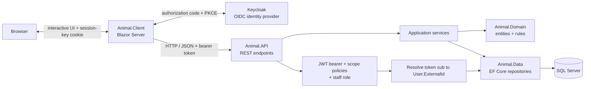
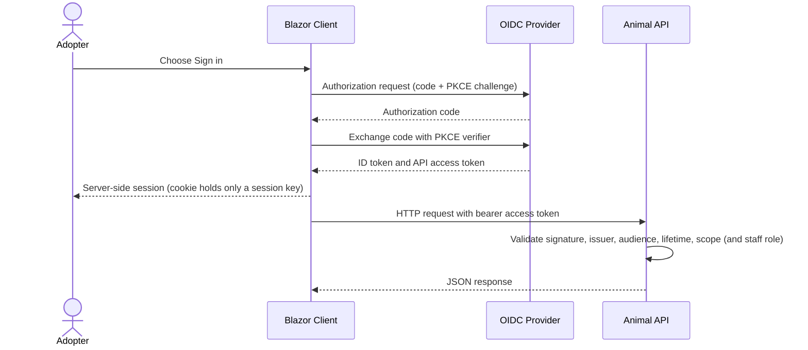

# Animal Adoption

Team 5 · Web Programming III

Animal Adoption is a .NET 10 web application with an ASP.NET Core API, a Blazor Server client, and SQL Server persistence. The client uses HTTP APIs and never references the data or domain projects.

## Projects

```text
src/Animal.Client/   Blazor Server UI, OIDC sign-in, typed HTTP clients
src/Animal.API/      REST controllers, request/response contracts, application services
src/Animal.Domain/   Entities, enums, business rules, domain exceptions
src/Animal.Data/     EF Core DbContext, configurations, migrations, repositories
tests/               xUnit unit and API integration tests
docs/diagrams/       Mermaid diagram sources and rendered images
```

Project references flow inward: `Animal.API` references `Animal.Domain` and `Animal.Data`; `Animal.Data` references `Animal.Domain`. `Animal.Client` references none of the backend projects.

## Architecture



The client and API are separate processes. `Animal.Client` calls the API through typed `HttpClient` services. Sign-in uses Keycloak with the authorization code flow and PKCE. The session and the access token stay on the client's server (`InMemoryTicketStore`); the browser only gets an `HttpOnly` cookie holding a session key, so page scripts never see a token and signing out ends that device's session. The API validates every bearer token (signature, issuer, audience, lifetime) and checks a scope per operation, plus the `staff` role for staff operations. Details: [auth.md](docs/milestone-3/auth.md).

### Sign-in and API request flow



Source diagrams: [service-diagram.mmd](docs/diagrams/service-diagram.mmd) and [services-class-diagram.mmd](docs/diagrams/services-class-diagram.mmd). The database diagram is [database-diagram.png](docs/diagrams/database-diagram.png) (source: [database-diagram.mmd](docs/diagrams/database-diagram.mmd)). To re-render the PNGs after changing a `.mmd` file, use https://mermaid.live or `npx @mermaid-js/mermaid-cli -i <file>.mmd -o <file>.png`.

## Run locally

Prerequisites (each machine, once):

- **.NET 10 SDK.** Check with `dotnet --list-sdks`; a .NET 8 SDK alone gives `NETSDK1045`. Install with `winget install Microsoft.DotNet.SDK.10` or from https://aka.ms/dotnet/download.
- **SQL Server Express LocalDB** (comes with Visual Studio, or install `SqlLocalDB.msi` from the SQL Server Express download → *Download Media* → *LocalDB*). Check with `sqllocaldb info`. Without it the API answers 500 on every database call. To use another SQL Server, set `ConnectionStrings__AnimalDb` instead.
- **EF Core tools 10:** `dotnet tool install --global dotnet-ef --version 10.0.12` (or `update` if an older version is installed).

If a build fails with `The file is locked by: "Animal.API (...)"`, stop the running API first.

Restore and build the solution:

```powershell
dotnet restore Team-5-Web-Programming.slnx
dotnet build Team-5-Web-Programming.slnx
```

In one terminal, start the API:

```powershell
dotnet run --project src/Animal.API
```

The API listens on `http://localhost:5015` and `https://localhost:7298`. Its OpenAPI document is available at `/openapi/v1.json` in Development.

In a second terminal, start the client:

```powershell
dotnet run --project src/Animal.Client
```

The client listens on `http://localhost:5012` and uses `AnimalApi:BaseUrl` from its configuration to reach the API. Browse pets without signing in.

In Visual Studio, you can start both processes together by right-clicking the solution, choosing **Configure Startup Projects**, selecting **Multiple startup projects**, and setting both `Animal.API` and `Animal.Client` to **Start**. The API must be listening on `http://localhost:5015` before the client loads API-backed pages.

### Sign-in (Keycloak)

Sign-in uses a local Keycloak in Docker. Follow [identity-provider-setup.md](docs/milestone-4/identity-provider-setup.md) once (about 10 minutes): it starts Keycloak with `docker compose` in `keycloak/`, imports the `animal` realm, and creates the test users `adopter1`, `adopter2` and `staff1` (staff role).

The authority, audience and client ID are already in `appsettings.Development.json`. The only value you set yourself is the client secret, which stays out of the repository:

```powershell
dotnet user-secrets set "Authentication:ClientSecret" "<secret from Keycloak>" --project src/Animal.Client
```

The Keycloak admin password goes in `keycloak/.env` (gitignored, copy `.env.example`). The API maps the validated token's `sub` to the local user's `ExternalId`; the provider never sends the database's numeric user ID. The local API CORS origin is configurable through `Cors:ClientOrigin` (Development defaults to `http://localhost:5012`).

### Profile picture

Signed-in users can upload a PNG or JPEG on **My profile**. The API (`/api/users/me/picture`) checks the file's real format and declared type, rejects files over 2 MB or 2048 × 2048 pixels before decoding, re-encodes the image with SkiaSharp (removing metadata), and stores it in the `ProfilePictures` table, so it shows on every device the user signs in on. There is no route with a user id: each user can only reach their own picture.

## Data and tests

EF Core mappings are in `src/Animal.Data/Configurations`; migrations are in `src/Animal.Data/Migrations`. Apply migrations with:

```powershell
dotnet ef database update --project src/Animal.Data --startup-project src/Animal.Data
```

Run the whole test suite with:

```powershell
dotnet test Team-5-Web-Programming.slnx
```

The tests need no Keycloak, Docker or database server: they sign their own test tokens and use in-memory SQLite. CI runs them on every pull request into `main` or the milestone branch.

| Type | Where | What it covers | Run only these |
|---|---|---|---|
| Unit | `tests/Animal.UnitTests` | Domain rules, application services with fakes, client API classes and token handling, layer rules | `dotnet test tests/Animal.UnitTests` |
| Integration | `tests/Animal.IntegrationTests/Api`, `Data`, `Client` | API status codes and responses through the real `Program.cs`, repositories, authentication and authorization, upload rules, failure handling, the client host | `dotnet test tests/Animal.IntegrationTests` |
| Contract | `tests/Animal.IntegrationTests/ClientContracts` | Each client API class against the real API, plus client failure handling ([testing.md](docs/milestone-4/testing.md)) | `dotnet test tests/Animal.IntegrationTests --filter "FullyQualifiedName~ClientContracts"` |
| End-to-end | `CrossDeviceProfileTests`, `ClientSignOutTests` | The cross-device profile and picture journey and sign-out, plus a manual check with Keycloak ([cross-device-manual-check.md](docs/milestone-4/cross-device-manual-check.md)) | `dotnet test tests/Animal.IntegrationTests --filter "FullyQualifiedName~CrossDevice\|FullyQualifiedName~ClientSignOut"` |

## Security documents (Milestone 4)

- [decisions.md](docs/milestone-4/decisions.md): security decisions (identity provider, tokens, picture rules, storage, secrets)
- [api-contracts.md](docs/milestone-4/api-contracts.md): picture endpoints and authorization changes
- [threat-model.md](docs/milestone-4/threat-model.md): threats, mitigations and the tests that prove them
- [secrets-and-config.md](docs/milestone-4/secrets-and-config.md): which settings are secret and where they live
- [auth.md](docs/milestone-3/auth.md): scope and role required by every endpoint

## Team conventions

- Work from an issue and branch, then submit a pull request for peer review.
- Keep `bin/`, `obj/`, `.vs/`, and `*.user` files out of commits.
- Keep Mermaid sources, README diagrams, and rendered images in sync when the architecture changes.
- Use only fictional data in seed rows and tests. Never commit credentials, access tokens, or production connection strings.
