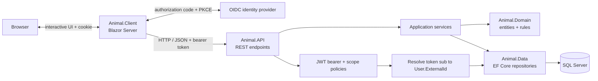
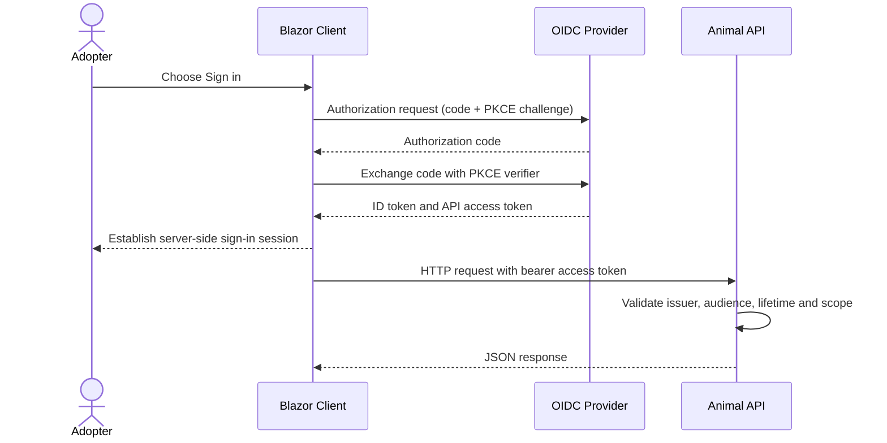

# Animal Adoption

Team 5 · Web Programming III

Animal Adoption is a .NET 10 web application with an ASP.NET Core API, a Blazor Server client, and SQL Server persistence. The client uses HTTP APIs and never references the data or domain projects.

## Projects

```text
src/Animal.Client/   Blazor Server UI, OIDC sign-in, typed HTTP clients
src/Animal.API/      REST controllers, request/response contracts, application services
src/Animal.Domain/   Entities, enums, business rules, domain exceptions
src/Animal.Data/     EF Core DbContext, configurations, migrations, repositories
tests/               xUnit unit and API integration tests
docs/diagrams/       Mermaid diagram sources and rendered images
```

Project references flow inward: `Animal.API` references `Animal.Domain` and `Animal.Data`; `Animal.Data` references `Animal.Domain`. `Animal.Client` references none of the backend projects.

## Architecture



The client and API are separate processes. `Animal.Client` calls the API through typed `HttpClient` services. Its OIDC code flow uses PKCE; the client secret, when required by the identity provider, stays in server-side configuration. The API validates bearer tokens and scope claims when WI-3 authentication is configured.

### Sign-in and API request flow



Source diagrams: [service-diagram.mmd](docs/diagrams/service-diagram.mmd) and [services-class-diagram.mmd](docs/diagrams/services-class-diagram.mmd). The database diagram is available at [database-diagram.png](docs/diagrams/database-diagram.png).

## Run locally

Install the .NET 10 SDK. Start SQL Server/LocalDB and configure the API connection string if the default LocalDB instance is unavailable.

Restore and build the solution:

```powershell
dotnet restore Team-5-Web-Programming.slnx
dotnet build Team-5-Web-Programming.slnx
```

In one terminal, start the API:

```powershell
dotnet run --project src/Animal.API
```

The API listens on `http://localhost:5015` and `https://localhost:7298`. Its OpenAPI document is available at `/openapi/v1.json` in Development.

In a second terminal, start the client:

```powershell
dotnet run --project src/Animal.Client
```

The client listens on `http://localhost:5012` and uses `AnimalApi:BaseUrl` from its configuration to reach the API. Browse pets without signing in. To enable sign-in, configure an OIDC authority and client ID for the client and the matching authority/audience for the API. Keep any client secret in user-secrets or an environment variable; never put it in browser code or committed settings.

In Visual Studio, you can start both processes together by right-clicking the solution, choosing **Configure Startup Projects**, selecting **Multiple startup projects**, and setting both `Animal.API` and `Animal.Client` to **Start**. The API must be listening on `http://localhost:5015` before the client loads API-backed pages.

For local OIDC configuration, set values with user-secrets from the repository root:

```powershell
dotnet user-secrets init --project src/Animal.Client
dotnet user-secrets set "Authentication:Authority" "https://your-provider.example/" --project src/Animal.Client
dotnet user-secrets set "Authentication:ClientId" "your-client-id" --project src/Animal.Client
dotnet user-secrets set "Authentication:ClientSecret" "your-server-side-secret" --project src/Animal.Client
```

Set the provider's API scopes with `Authentication:Scopes` and align the API's `Authentication:Authority` and `Authentication:Audience` settings. The API maps the validated token's `sub` to the local user's `ExternalId`; the provider does not need to send the database's numeric user ID. The local API CORS origin is configurable through `Cors:ClientOrigin` (Development defaults to `http://localhost:5012`).

## Data and tests

EF Core mappings are in `src/Animal.Data/Configurations`; migrations are in `src/Animal.Data/Migrations`. Apply migrations with:

```powershell
dotnet ef database update --project src/Animal.Data --startup-project src/Animal.API
```

Run the test suite with:

```powershell
dotnet test Team-5-Web-Programming.slnx
```

Unit tests cover domain rules. API integration tests run the real `Program.cs` registrations against an in-memory SQLite database.

## Team conventions

- Work from an issue and branch, then submit a pull request for peer review.
- Keep `bin/`, `obj/`, `.vs/`, and `*.user` files out of commits.
- Keep Mermaid sources, README diagrams, and rendered images in sync when the architecture changes.
- Use only fictional data in seed rows and tests. Never commit credentials, access tokens, or production connection strings.
