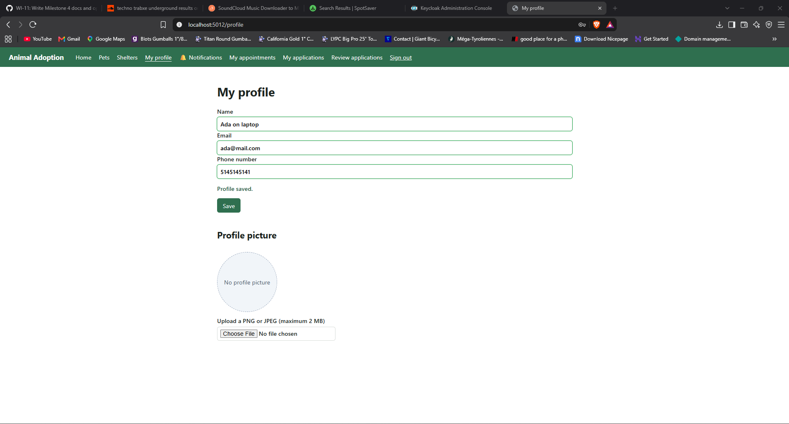
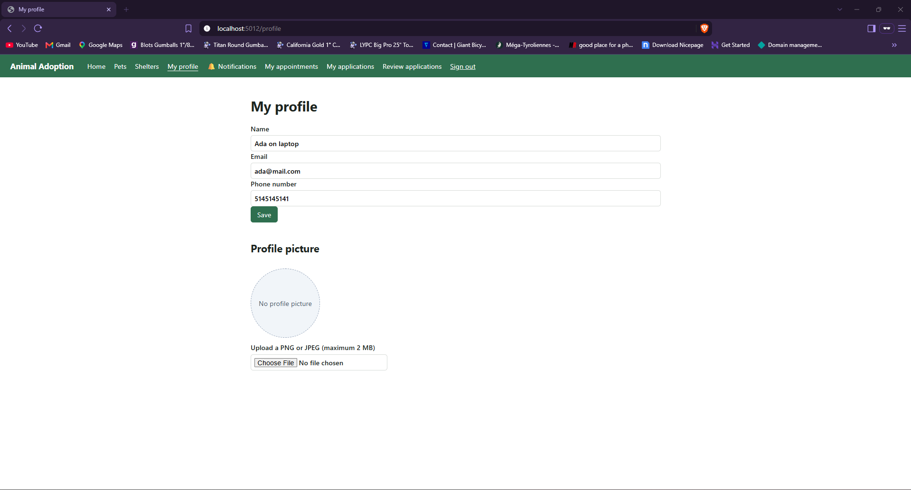
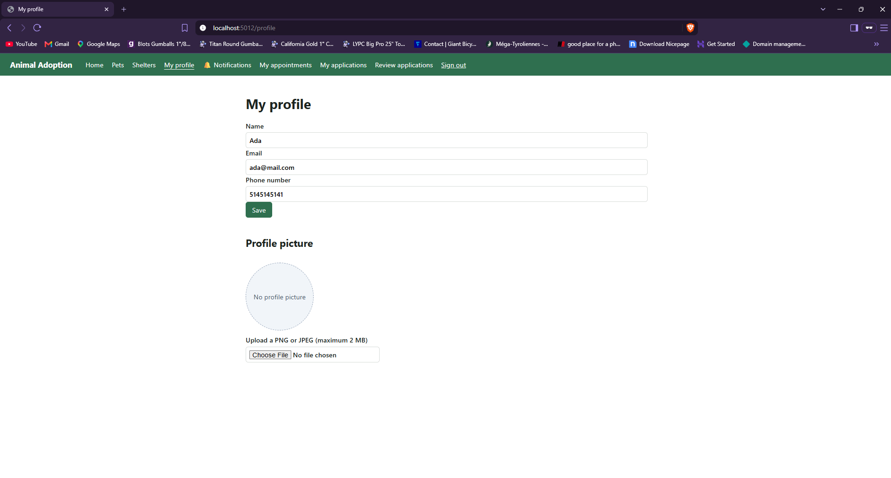
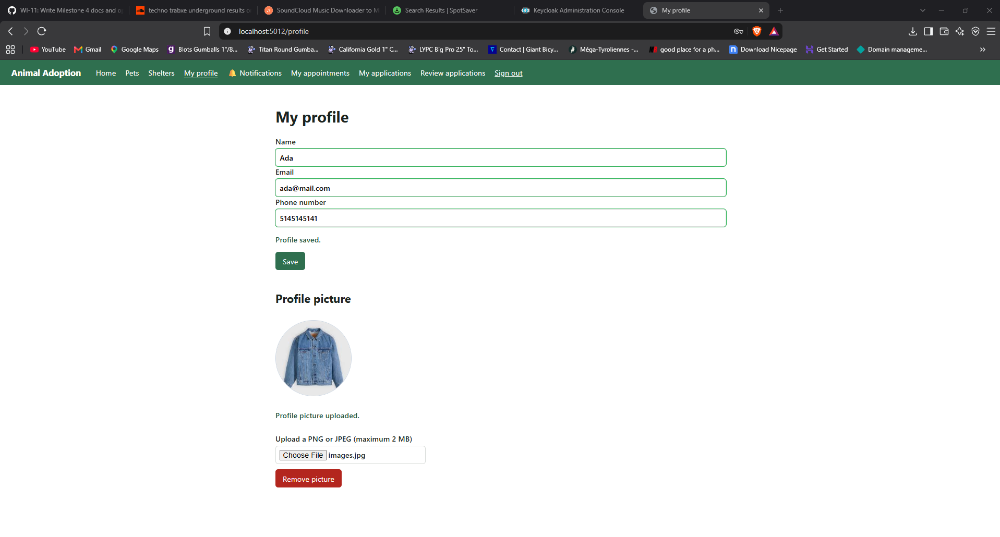
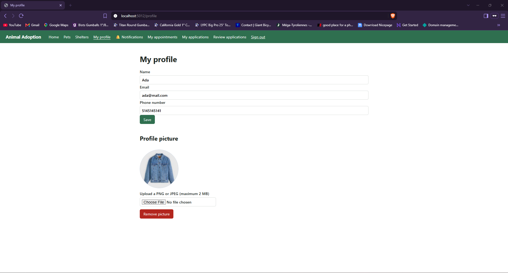
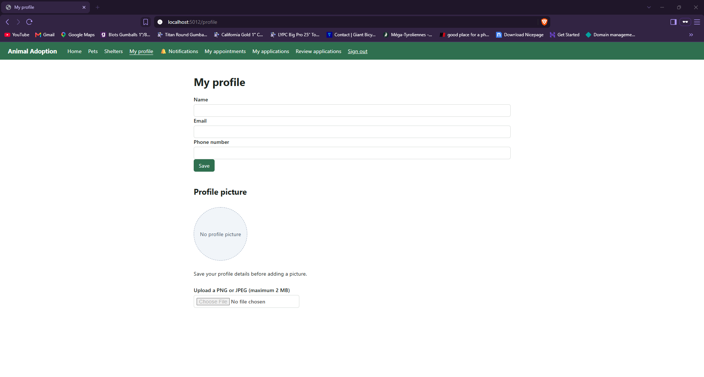
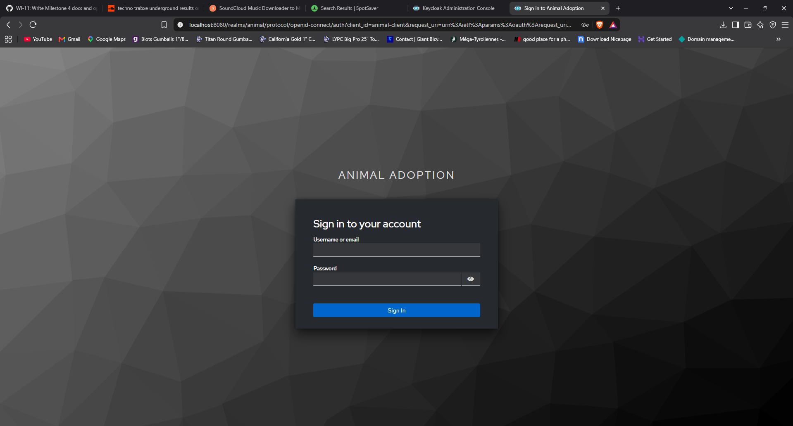

# Cross-Device Manual Check (WI-10)

**Status: done.** All 12 steps passed on 2026-11-23 with the real Keycloak, after the picture page (WI-6, #56) was merged. See Results below.

This is the manual version of the spec's cross-device journey, with the real Keycloak. The same journey is automated at the API level in `CrossDeviceProfileTests` (profile and picture: A uploads, B gets the same bytes, a replacement shows on B, another user can't read or replace it, a rejected upload leaves B's view unchanged) and at the client level in `ClientSignOutTests`. Both run in CI without Keycloak.

**What it proves:** the profile follows the **account**, not a copied session. Each "device" signs in by itself, and nothing (no token, cookie or link) is moved from one to the other.

## Setup

1. Keycloak, the API and the client are running (`identity-provider-setup.md`, steps 1 to 5).
2. Use two separate browsers, or one normal window and one private window. They don't share cookies, so they act like two devices.
   - **Device A:** the normal window
   - **Device B:** the private window
3. Test users: `adopter1` (the owner) and `adopter2` (the other user).

## Steps

| # | Device | Do | Expected | Screenshot |
|---|---|---|---|---|
| 1 | A | Sign in as `adopter1`, open **My profile**, save a name (for example "Ada on laptop") | Saved | `01-a-profile-saved.png` |
| 2 | B | Sign in as `adopter1` (type the password, don't copy anything from A), open **My profile** | Shows "Ada on laptop" | `02-b-sees-profile.png` |
| 3 | A | Change the name to "Ada updated" and save | Saved | |
| 4 | B | Refresh **My profile** | Shows "Ada updated" | `04-b-sees-update.png` |
| 5 | A | Upload a PNG profile picture | Picture shows on A | `05-a-picture.png` |
| 6 | B | Refresh **My profile** | Same picture shows on B | `06-b-sees-picture.png` |
| 7 | B | Sign out, sign in as `adopter2`, open **My profile** | `adopter2`'s own profile (or "no profile yet"), never Ada's name or picture | `07-other-user.png` |
| 8 | B | Open `http://localhost:5015/api/users/1` (Ada's id) | 404 or 401. There's no route that takes a user id | |
| 9 | A | Click **Sign out** | Back on the home page, signed out | |
| 10 | A | Open **My profile** | Asked to sign in again (the app sends you to the Keycloak sign-in page) | `10-a-signed-out.png` |
| 11 | B | (Sign back in as `adopter1` if needed) refresh **My profile** | Still works: signing out on A didn't touch B | |
| 12 | A | Click **Sign in** | Keycloak asks for the password again | |

Save the screenshots in `docs/milestone-4/screenshots/cross-device/` and link them in the milestone PR (#44).

## Things to look for along the way

- No token appears in any URL, page or link (check the address bar and View Source).
- In the browser's dev tools (Application → Cookies), the `.AspNetCore.Cookies` cookie is `HttpOnly` and short (a session key, not a token).

## Results

| Date | Who | Steps passed | Notes |
|---|---|---|---|
| 2026-11-23 | Aiden | 1 to 12 (all) | Windows, Docker Desktop (Keycloak 26.0.7), SQL Server LocalDB. Device A: normal browser window. Device B: private window, signed in separately by typing the password (nothing copied from A). |

### Screenshots

| Step | Device | What it shows |
|---|---|---|
| 1 | A |  |
| 2 | B |  |
| 4 | B |  |
| 5 | A |  |
| 6 | B |  |
| 7 | B |  |
| 10 | A |  |

### What this shows

- The profile and the picture follow the **account**: Device B got them from shared storage after signing in on its own. No token, cookie or link was moved between the devices.
- Another user (`adopter2`) only ever saw their own profile, and `/api/users/1` didn't exist.
- Signing out on Device A ended only A's session: B kept working, and A had to type the password again.

The same journey runs automatically in CI: `CrossDeviceProfileTests` (profile and picture, API level) and `ClientSignOutTests` (sign-out and copied cookies, client level).
