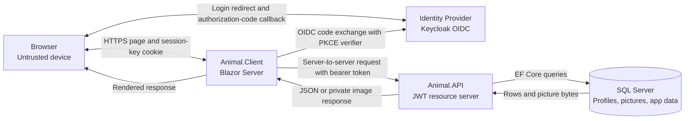

# Milestone 4 threat model

This model describes the implementation on `feature/milestone-4-security` after WI-2 through WI-8. The application is a Blazor Server client, an OAuth/OIDC identity provider (Keycloak in local development), an ASP.NET API, and SQL Server. The browser and request data are untrusted. The API makes authorization decisions from validated token claims and resolves the caller's `sub` to a local user; client-side UI checks are not a security boundary.

## Data flow

The browser carries the sign-in redirects and the client's HttpOnly session-key cookie. The client stores the authentication ticket and tokens in its server-side in-memory ticket store. It sends API access tokens server-to-server. The API reads/writes profiles, pictures, and other application data in SQL Server. Production traffic must use HTTPS; the local Keycloak HTTP endpoint is development-only.

## Threats, mitigations, and test evidence

| Area | Threat (STRIDE) | Mitigation and location | Test evidence |
|---|---|---|---|
| Authentication | Forged, malformed, expired, wrong-issuer, or wrong-audience token is accepted (Spoofing) | JWT bearer middleware validates signature/key, issuer, audience, and lifetime. Metadata HTTPS is required outside Development. `src/Animal.API/Program.cs` | `tests/Animal.IntegrationTests/Api/AuthTests.cs`: `ProtectedWrite_WithMalformedBearerToken_ReturnsUnauthorized`, `ProtectedWrite_WithWrongSigningKey_ReturnsUnauthorized`, `ProtectedWrite_WithExpiredTokenOutsideClockSkew_ReturnsUnauthorized`, `ProtectedWrite_WithWrongIssuer_ReturnsUnauthorized`, `ProtectedWrite_WithWrongAudience_ReturnsUnauthorized` |
| Authentication | An intercepted authorization code is replayed or used without proof of the initiating client (Spoofing) | OIDC authorization-code flow uses PKCE; Keycloak requires S256 and disables password grant. `src/Animal.Client/Program.cs`, `keycloak/animal-realm.json` | `tests/Animal.IntegrationTests/Client/ClientTokenHandlingTests.cs`: `SignIn_UsesCodeFlowWithPkceAndKeepsTokensInTheCookie` verifies client configuration; the manual Keycloak checks in `docs/milestone-4/identity-provider-setup.md` verify PKCE is required and password grant is refused |
| Authorization | A signed-in caller without the required scope can use a protected operation (Elevation of privilege) | Fallback policy requires authentication; controller actions use named scope policies and public actions are explicitly anonymous. `src/Animal.API/Authorization/AuthorizationPolicies.cs`, controller attributes | `AuthTests.ProtectedWrite_WithValidTokenMissingScope_ReturnsForbidden`, `AuthTests.AuthorizationOptions_FallbackPolicy_RequiresAuthenticatedUser`, `AuthTests.ControllerEndpoints_HaveExplicitAuthorizationMetadata` |
| Authorization | Any user can request optional write/review scopes and perform staff actions (Elevation of privilege) | Staff operations require both the exact scope and a validated `roles=staff` claim. `AuthorizationPolicies.cs`, `ScopeClaims.cs`, `keycloak/animal-realm.json` | `AuthTests.StaffOperation_WithScopeButNoStaffRole_ReturnsForbidden`, `StaffOperation_WithStaffRoleButNoScope_ReturnsForbidden`, `StaffOperation_WithOtherRole_ReturnsForbidden`, `StaffOperation_RoleOnlyInNestedRealmAccessClaim_ReturnsForbidden` |
| Profile data | Caller changes an identifier or forges a local-user claim to read or update another user's profile (Elevation of privilege / Tampering) | Profile endpoints address only `/api/users/me`; caller identity comes from validated `sub`, then maps to the local profile. Forged `local_user_id` token claims are discarded during claims transformation. `UsersController.cs`, `HttpCurrentUser.cs`, `SubjectToUserIdClaimsTransformation.cs`, `UserService.cs` | `tests/Animal.IntegrationTests/Api/UsersEndpointTests.cs`: `TwoUsers_GetMyProfile_ReturnsOnlyTheirOwnProfile`, `UserCollectionRoutes_AreNotAvailable`; `tests/Animal.IntegrationTests/Api/CrossDeviceProfileTests.cs`: `Profile_SavedOnDeviceA_IsReadOnDeviceB_AndOtherUsersCantReachIt` |
| Profile data | Provider subject or internal details leak in profile responses or errors (Information disclosure) | Response DTO omits provider subject; exception handler strips exception/stack details. `src/Animal.API/Contracts/UserResponse.cs`, `src/Animal.API/Program.cs`, `UnhandledExceptionHandler.cs` | `UsersEndpointTests.GetMyProfile_DoesNotSerializeExternalId`, `CrossDeviceProfileTests.ProfileResponse_NeverContainsATokenOrTheExternalId`, `UsersEndpointTests.PutMyPicture_WhenStoreThrows_ReturnsSanitizedProblemDetails_AndKeepsProfileAndPictureUnchanged` |
| Image upload and storage | Attacker uploads a renamed executable, spoofed MIME type, unsupported/corrupt image, oversized payload, or excessive dimensions (Tampering / Denial of service) | API limits request to 3 MB and image to 2 MB; validates PNG/JPEG signature and declared MIME, decodes with SkiaSharp, caps dimensions at 2048x2048, then re-encodes before storage. `UsersController.cs`, `ProfilePictureRules.cs`, `UserService.cs` | `tests/Animal.UnitTests/Domain/ProfilePictureRulesTests.cs` (size, signature, type mismatch); `tests/Animal.IntegrationTests/Api/UsersEndpointTests.cs`: `PutMyPicture_CorruptImage_ReturnsBadRequest_AndLeavesExistingPictureUnchanged`, `PutMyPicture_Gif_ReturnsBadRequest_AndLeavesExistingPictureUnchanged`, `PutMyPicture_JpegDeclaredAsPng_ReturnsBadRequest_AndLeavesExistingPictureUnchanged`, `PutMyPicture_DimensionsOver2048_ReturnsBadRequest_AndLeavesExistingPictureUnchanged`, `PutMyPicture_Over2Mb_ReturnsBadRequest_AndLeavesExistingPictureUnchanged`, `PutMyPicture_RequestOver3Mb_ReturnsPayloadTooLarge_AndLeavesExistingPictureUnchanged` |
| Image upload and storage | Caller reads, overwrites, or deletes another user's private picture (Information disclosure / Tampering) | Picture API uses only `/api/users/me/picture`, resolves validated subject to local user ID, stores by that ID, and serves `Cache-Control: private, no-store`. `UsersController.cs`, `UserService.cs`, `ProfilePictureStore.cs` | `tests/Animal.IntegrationTests/Api/CrossDeviceProfileTests.cs`: `Picture_UploadedOnDeviceA_IsServedToDeviceB_AndOtherUsersCantReadOrReplaceIt`, `PictureResponse_IsPrivateAndCarriesNoToken`; `UsersEndpointTests.DeleteMyPicture_RemovesPicture` |
| Device and session lifecycle | A copied session cookie remains valid after the user signs out (Spoofing) | Authentication ticket and tokens are stored server-side; logout removes the ticket, clears the cookie, and ends the Keycloak session for that device. Logout is POST and antiforgery-validated. `src/Animal.Client/Program.cs`, `InMemoryTicketStore.cs` | `tests/Animal.IntegrationTests/Client/ClientSignOutTests.cs`: `SignOut_CopiedCookieFromBeforeSignOut_NoLongerWorks`, `SignOut_OnDeviceA_EndsOnlyDeviceA`; the helper posts the antiforgery token |
| Device and session lifecycle | A client cookie continues beyond its access-token expiry or slides indefinitely (Spoofing) | Cookie lifetime is 30 minutes, non-sliding; validation rejects a ticket if its access token expired, and the token provider will not attach an expired token. `Program.cs`, `AuthCookieEvents.cs`, `AccessTokenProvider.cs` | `tests/Animal.IntegrationTests/Client/ClientTokenHandlingTests.cs`: `AuthCookie_IsHttpOnlyLaxNotSlidingAndExpiresWithTheToken`; `tests/Animal.UnitTests/Client/AccessTokenTests.cs`: `CookieValidation_ExpiredAccessToken_RejectsTheCookie`, `Handler_SignedOutOrExpired_SendsNoAuthorizationHeader` |

## Remaining risks

- Images are not scanned for malware. Signature checks, bounded decoding, and re-encoding reduce risk but are not a virus scanner.
- Client sessions live in process memory. A restart signs users out; multiple client instances need a shared protected ticket store and coordinated invalidation. There is no refresh-token flow; users must sign in again after token expiry.
- Logout ends only the current device's session. Other devices remain signed in until logout or expiry; global revocation is not implemented.
- There is no application-level rate limit on sign-in, profile, or upload requests. Per-file limits do not stop repeated requests.
- Database backup security, encryption at rest, data retention/deletion, production key management, and monitoring/alerting are deployment responsibilities not enforced by this repository.
- The checked-in Keycloak compose file runs dev mode over HTTP with its in-container development database. It is local-only and not a production identity-provider deployment.
- A compromised browser/device can use its live session, and a compromised client server can access server-side tickets and tokens.
- Tests use locally signed test tokens and test stores. They verify application behavior, not production identity-provider or infrastructure security. Follow the manual Keycloak validation in `identity-provider-setup.md` as well.

## Requested peer review

- [ ] Aiden: authentication and authorization rows.
- [ ] Darcy: upload and storage rows.

Record each review and address findings on the WI-9 pull request before merging. These reviews are pending.
